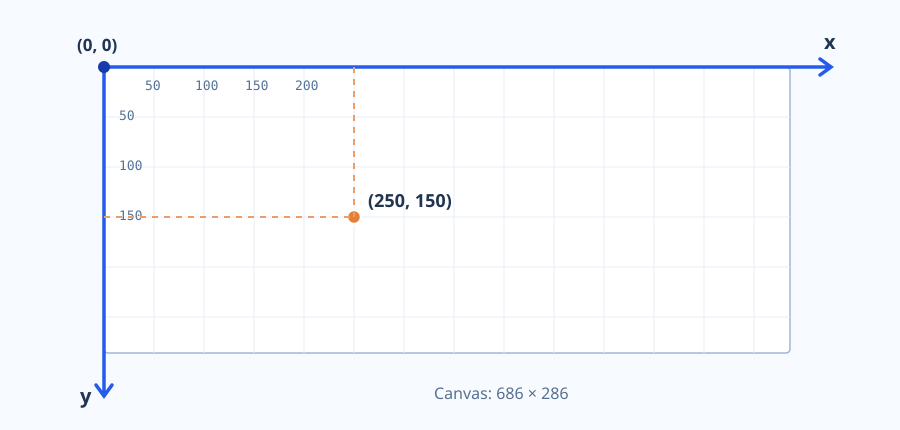

# Graphics primitives in JavaScript

We will implement computer graphics algorithms in **JavaScript**, using the browser's **Canvas 2D API**. The algorithms themselves will be written by us; Canvas merely provides the drawing surface. This chapter introduces the basic operations we will use throughout the course.

## 1. The drawing surface and coordinate system

The HTML `<canvas>` element defines a rectangular drawing surface. Its `width` and `height` attributes determine the internal drawing dimensions; the displayed CSS dimensions may be different.

```html
<canvas id="picture" width="640" height="400"></canvas>
```

The coordinate system has its **origin in the upper-left corner**. The \(x\)-coordinate increases to the right, and the \(y\)-coordinate increases **downward**.



Points are specified by ordered pairs \((x,y)\). For a canvas of width \(W\) and height \(H\), the visible drawing region corresponds to \(0\le x<W\) and \(0\le y<H\). Canvas drawing commands accept fractional coordinates as well; the final result is still rasterized.

> **Important:** Canvas coordinates do not necessarily correspond one-to-one to physical display pixels. Internal dimensions, CSS dimensions, and device pixel density may all differ. Our demonstrations use internal Canvas coordinates.

## 2. The 2D drawing context

Drawing methods belong to a two-dimensional context (`CanvasRenderingContext2D`):

```javascript
const canvas = document.querySelector("#picture");
const ctx = canvas.getContext("2d");
```

In later demonstrations the `ctx` variable is already available. Editable examples use a `draw(ctx, params)` function as their entry point; **this is a convention of this website**, not a built-in Canvas function.

## 3. Pixels and rectangles

Canvas 2D has no dedicated `putPixel()` operation. We can represent one logical pixel with a filled \(1\times1\) rectangle:

```javascript
function putPixel(ctx, x, y, color) {
    ctx.fillStyle = color;
    ctx.fillRect(x, y, 1, 1);
}
```

`fillRect(x, y, w, h)` draws a filled rectangle; `strokeRect(x, y, w, h)` draws only its outline. The `x` and `y` arguments indicate the upper-left corner, while `w` and `h` specify its dimensions.

```javascript
ctx.fillStyle = "#2563eb";
ctx.fillRect(80, 60, 120, 70);
ctx.strokeStyle = "#e07c35";
ctx.lineWidth = 3;
ctx.strokeRect(240, 60, 120, 70);
```

`clearRect(0, 0, W, H)` makes the given area transparent; it does not fill it with a background color. Use a filled rectangle when an opaque background is required.

## 4. Lines, paths and polygons

A line segment is part of a *path*. `beginPath()` starts a new path, `moveTo()` sets its starting point, `lineTo()` adds a segment, and `stroke()` draws the outline.

```javascript
ctx.beginPath();
ctx.moveTo(80, 150);
ctx.lineTo(320, 90);
ctx.stroke();
```

Multiple `lineTo()` calls create polylines and polygons. `closePath()` connects the current subpath to its starting point. `fill()` fills the enclosed region; for filling purposes, open subpaths are implicitly closed.

```javascript
ctx.beginPath();
ctx.moveTo(90, 220);
ctx.lineTo(210, 110);
ctx.lineTo(340, 220);
ctx.closePath();
ctx.fill();
ctx.stroke();
```

`strokeStyle` specifies the outline color, `fillStyle` the fill color, and `lineWidth` the line thickness.

## 5. Circles and arcs

`arc(cx, cy, r, start, end)` appends a circular arc to the current path. The center is \((c_x,c_y)\), the radius is \(r\), and angles are given **in radians**.

```javascript
ctx.beginPath();
ctx.arc(180, 160, 75, 0, 2 * Math.PI);
ctx.stroke();
```

A complete circle uses the interval from \(0\) to \(2\pi\). Angle zero points rightward. Since the canvas \(y\)-axis points downward, positive angles appear **clockwise on screen**. The optional sixth argument, `counterclockwise`, reverses the direction.

## 6. Curves and text

Canvas supports quadratic and cubic Bézier drawing through `quadraticCurveTo()` and `bezierCurveTo()`. Here we introduce them only as drawing primitives.

```javascript
ctx.beginPath();
ctx.moveTo(80, 250);
ctx.bezierCurveTo(170, 40, 330, 390, 430, 150);
ctx.stroke();
```

When studying curve algorithms later, **we will not use built-in Canvas curves to calculate them**. We will compute the curve points ourselves and draw them using line segments or logical pixels.

`fillText(text, x, y)` draws text. The `font`, `textAlign` and `textBaseline` properties control its appearance.

## 7. Interactive demonstration

The demonstration opens in a separate browser tab. The editable JavaScript code appears **on the left**; the drawing and a parameter panel appear **on the right**. You can switch between pixels, paths, circular arcs, and built-in Bézier drawing.

Click **Run** after editing the code. Parameter changes trigger a new run automatically. **Reset code** reloads the original example.

[Open the interactive demonstration](demo.html?demo=primitives)

**Try this:** change line thickness, use another color, and then edit a primitive's coordinates in the code. Observe the orientation of the Canvas coordinate system.

---

This chapter introduced the browser's **native** drawing methods. We will use them to implement raster and geometric algorithms in the following chapters.
