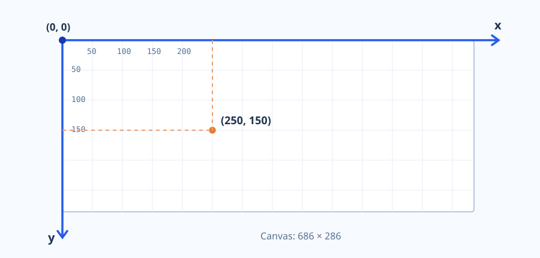

# Grafikus primitívek JavaScriptben

A számítógépi grafikai algoritmusokat **JavaScriptben**, a böngésző **Canvas 2D API-jával** fogjuk megvalósítani. Az algoritmusokat saját kóddal írjuk meg; a Canvas csupán a rajzolás felületét adja. Ebben a fejezetben áttekintjük a később használatos alapműveleteket.

## 1. A rajzfelület és a koordinátarendszer

A `<canvas>` HTML-elem egy téglalap alakú rajzfelületet jelöl ki. A `width` és `height` attribútum a belső rajzfelület méretét adja meg; a CSS-ben beállított méret ettől eltérhet.

```html
<canvas id="picture" width="640" height="400"></canvas>
```

A böngészőben a koordinátarendszer **origója a bal felső sarokban van**. Az \(x\) koordináta jobbra, az \(y\) koordináta lefelé növekszik.



A rajzfelület pontjainak koordinátáit az \((x,y)\) rendezett számpár írja le. \(W\) szélesség és \(H\) magasság esetén a látható rajzterület a \(0\le x<W\), \(0\le y<H\) tartományhoz tartozik. A Canvas rajzműveletei valós koordinátákat is elfogadnak; a képernyőn végül raszteres kép keletkezik.

> **Fontos:** a Canvas koordinátái nem azonosak automatikusan a megjelenítő fizikai pixelkoordinátáival. A belső rajzméret, a CSS-méret és a képernyő pixelsűrűsége eltérhet egymástól. A demonstrációk a belső Canvas-koordinátákat használják.

## 2. A 2D rajzolási környezet

A rajzolófüggvényeket a Canvas kétdimenziós környezetén (`CanvasRenderingContext2D`) keresztül érjük el:

```javascript
const canvas = document.querySelector("#picture");
const ctx = canvas.getContext("2d");
```

A későbbi demonstrációkban a `ctx` változó már rendelkezésre áll, tehát nem kell minden algoritmusban újra létrehozni. A szerkeszthető példák belépési pontja egy `draw(ctx, params)` függvény; **ez a weboldal saját megállapodása**, nem a Canvas beépített függvénye.

## 3. Képpontok és téglalapok

A Canvas 2D API-nak nincs önálló `putPixel()` művelete. Egy \(1\times1\) méretű kitöltött téglalappal azonban megjelölhetünk egy logikai képpontot:

```javascript
function putPixel(ctx, x, y, color) {
    ctx.fillStyle = color;
    ctx.fillRect(x, y, 1, 1);
}
```

A téglalapokat a `fillRect(x, y, w, h)` kitölti, a `strokeRect(x, y, w, h)` pedig csak a keretüket rajzolja. Az `x` és `y` a téglalap bal felső sarkát, `w` és `h` a méretét jelölik.

```javascript
ctx.fillStyle = "#2563eb";
ctx.fillRect(80, 60, 120, 70);
ctx.strokeStyle = "#e07c35";
ctx.lineWidth = 3;
ctx.strokeRect(240, 60, 120, 70);
```

A `clearRect(0, 0, W, H)` a kijelölt területet átlátszóvá teszi, nem adott színűre festi. Egyszínű háttérhez kitöltött téglalapot használhatunk.

## 4. Szakaszok, útvonalak és poligonok

A szakasz egy *útvonal* (`path`) része. A `beginPath()` új útvonalat kezd, a `moveTo()` a kezdőpontot adja meg, a `lineTo()` pedig új szakaszt illeszt az útvonalhoz. A `stroke()` kirajzolja a kontúrt.

```javascript
ctx.beginPath();
ctx.moveTo(80, 150);
ctx.lineTo(320, 90);
ctx.stroke();
```

Több `lineTo()` hívással töröttvonalat vagy poligont kapunk. A `closePath()` az aktuális részútvonalat összeköti a kezdőpontjával. A `fill()` kitölti a körülhatárolt területet; a kitöltés nyitott részútvonalak esetén is zártnak tekinti az alakzatot.

```javascript
ctx.beginPath();
ctx.moveTo(90, 220);
ctx.lineTo(210, 110);
ctx.lineTo(340, 220);
ctx.closePath();
ctx.fill();
ctx.stroke();
```

A `strokeStyle` a kontúr, a `fillStyle` a kitöltés színét állítja be. A `lineWidth` a vonalvastagságot szabályozza.

## 5. Körök és körívek

A `arc(cx, cy, r, start, end)` körívet ad az aktuális útvonalhoz. A középpont \((c_x,c_y)\), a sugár \(r\); a szögeket **radiánban** kell megadni.

```javascript
ctx.beginPath();
ctx.arc(180, 160, 75, 0, 2 * Math.PI);
ctx.stroke();
```

A teljes körhöz \(0\)-tól \(2\pi\)-ig rajzolunk. A nulla szög a kör középpontjától jobbra mutató sugárnak felel meg. A Canvas lefelé növekvő \(y\)-tengelye miatt a pozitív szögirány a képernyőn **az óramutató járásával megegyező** irány. A hatodik `counterclockwise` paraméterrel a bejárási irány megfordítható.

## 6. Görbék és szöveg

A Canvas másod- és harmadfokú Bézier-görbék rajzolását is támogatja a `quadraticCurveTo()` és a `bezierCurveTo()` függvényekkel. Ezeket itt csak mint grafikus primitíveket mutatjuk be.

```javascript
ctx.beginPath();
ctx.moveTo(80, 250);
ctx.bezierCurveTo(170, 40, 330, 390, 430, 150);
ctx.stroke();
```

A későbbi görbealgoritmusoknál **nem a kész Canvas-görberajzolót fogjuk használni a számításhoz**: a görbepontokat saját algoritmussal állítjuk elő, majd szakaszokkal vagy képpontokkal jelenítjük meg.

Feliratokat a `fillText(text, x, y)` művelettel írhatunk ki. A `font`, `textAlign` és `textBaseline` tulajdonságokkal szabályozható a szöveg megjelenítése.

## 7. Interaktív demonstráció

A demonstráció külön lapon nyílik meg. **Bal oldalon a JavaScript-kód szerkeszthető**, jobb oldalon látható a rajz és az adott példához tartozó paraméterpanel. A példaválasztóval kipróbálhatók a képpontok, az útvonalak, a körívek és a beépített Bézier-rajzolás is.

A kód módosítása után a **Futtatás** gombbal frissül a kép; a paraméterek módosítása automatikusan újrafuttatja a példát. A **Kód visszaállítása** gomb az eredeti algoritmust tölti vissza.

[Demonstráció megnyitása](demo.html?demo=primitives)

**Próbáld ki:** változtasd meg a vonalvastagságot, rajzolj más színnel, majd módosítsd valamelyik primitív koordinátáit a kódban. Figyeld meg a Canvas koordinátarendszerének irányát.

---

Ebben a fejezetben a böngésző **natív** rajzolóeszközeit ismertük meg. A következő fejezetekben ezeket már konkrét raszteres és geometriai algoritmusok megvalósításához használjuk.
